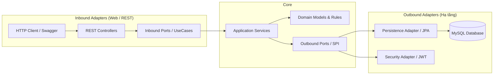
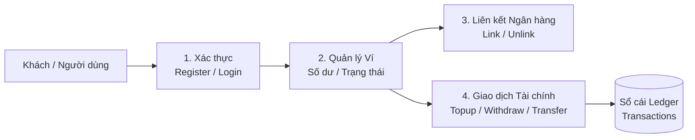
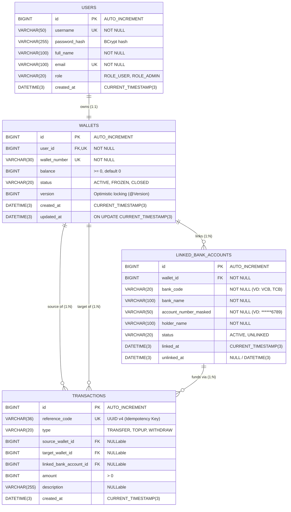

# Digital Wallet System

Hệ thống Backend RESTful API cho dịch vụ Ví điện tử. Ứng dụng triển khai theo Hexagonal Architecture, đảm bảo tính độc lập giữa Business và Infrastructure.

---

## 1. Công nghệ sử dụng

- **Ngôn ngữ & Nền tảng:** Java, Spring Boot.
- **Lưu trữ & ORM:** MySQL, Spring Data JPA, Hibernate.
- **Mapper & Utilities:** MapStruct, Lombok.
- **API:** OpenAPI.
- **Kiểm thử:** JUnit, Mockito.
- **Đóng gói:** Docker.

---

## 2. Kiến trúc hệ thống

Dự án áp dụng Hexagonal Architecture: Business core (`Domain` & `Application`) nằm ở trung tâm, không phụ thuộc vào Framework hay Database. Mọi giao tiếp của Business và Infrastructure đều thông qua Ports và Adapters.
- Architecture docs: [digitalwallet-docs/architecture](digitalwallet-docs/architecture.md)
- Đọc thêm về Hexagonal Architecture: https://github.com/thombergs/buckpal

---

## 3. Đặc tả chức năng & Danh mục API

Hệ thống tập trung vào 4 nhóm nghiệp vụ chính:

ERD Schema:

- SwaggerAPI: https://vllddlvh.github.io/SAUETDigitalWallet/digitalwallet-docs/swaggerAPI/
- API-Contract: [digitalwallet-docs/apicontract](digitalwallet-docs/apicontract.md)
- Business docs: [digitalwallet-docs/business](digitalwallet-docs/business.md)
- Database docs: [digitalwallet-docs/dbanalysis](digitalwallet-docs/dbanalysis.md)

### 3.1. Xác thực & Tài khoản (`/api/v1/auth`)

| Phương thức | Endpoint                | Quyền hạn | Mô tả                                                                                  |
| :---------- | :---------------------- | :-------- | :------------------------------------------------------------------------------------- |
| `POST`      | `/api/v1/auth/register` | Public    | Đăng ký tài khoản mới; tự động khởi tạo ví chính (số dư `0 VND`, trạng thái `ACTIVE`). |
| `POST`      | `/api/v1/auth/login`    | Public    | Đăng nhập bằng `username` / `password`, trả về JWT Access Token (Bearer).              |

### 3.2. Quản lý Ví điện tử (`/api/v1/wallets`)

| Phương thức | Endpoint             | Quyền hạn     | Mô tả                                                                                             |
| :---------- | :------------------- | :------------ | :------------------------------------------------------------------------------------------------ |
| `GET`       | `/api/v1/wallets/me` | Authenticated | Lấy thông tin ví, số ví định danh (`wallet_number`), số dư khả dụng (`balance`) và trạng thái ví. |

### 3.3. Liên kết Ngân hàng (`/api/v1/linked-banks`)

| Phương thức | Endpoint                    | Quyền hạn     | Mô tả                                                                          |
| :---------- | :-------------------------- | :------------ | :----------------------------------------------------------------------------- |
| `POST`      | `/api/v1/linked-banks`      | Authenticated | Liên kết tài khoản ngân hàng (mã hóa/che số tài khoản `account_number_masked`). |
| `GET`       | `/api/v1/linked-banks`      | Authenticated | Lấy danh sách các tài khoản ngân hàng đang kích hoạt (`ACTIVE`) của ví.         |
| `DELETE`    | `/api/v1/linked-banks/{id}` | Authenticated | Hủy liên kết tài khoản ngân hàng (Soft-delete: cập nhật trạng thái `UNLINKED`). |

### 3.4. Giao dịch Tài chính (`/api/v1/transactions`)

| Phương thức | Endpoint                         | Quyền hạn     | Mô tả                                                                      |
| :---------- | :------------------------------- | :------------ | :------------------------------------------------------------------------- |
| `POST`      | `/api/v1/transactions/topup`    | Authenticated | Nạp tiền từ tài khoản ngân hàng liên kết vào ví.                           |
| `POST`      | `/api/v1/transactions/withdraw` | Authenticated | Rút tiền từ ví về tài khoản ngân hàng liên kết (kiểm tra số dư khả dụng). |
| `POST`      | `/api/v1/transactions/transfer` | Authenticated | Chuyển tiền nội bộ sang ví khác theo số ví (`target_wallet_number`).       |
| `GET`       | `/api/v1/transactions`          | Authenticated | Lấy lịch sử giao dịch (nạp, rút, chuyển, nhận tiền) của ví.                |

---

## 4. Gợi ý các cải tiến cho Pha 2

- Phase 2 - suggestion: [digitalwallet-docs/phase2_suggestion](digitalwallet-docs/phase2_suggestion.md)
### 4.1. Về Business

- Thay đổi quan hệ giữa User và Wallet thành 1 - N để một User có thể quản lý nhiều ví (ví USD, VNĐ,...)
### 4.2. Về một số use-cases liên quan tới race condition

- Use-case 1: Khi yêu cầu data từ frontend được gửi nhiều lần, back-end trả về kết quả giống nhau cho những request này. Vậy vấn đề mình gợi ý để các bạn giải quyết là làm sao cho khi thanh toán được khởi tạo, hệ thống payment cần trừ tiền đúng 1 lần để sao cho một message với cùng một nội dung thì được gửi đúng 1 lần tới user.
- Use-case 2: Số dư hiện tại của User là N, User thực hiện cùng lúc hai request chuyển tiền với lần lượt số tiền là A và B (A + B > N). Cả hai request đều đọc số dư N trước khi bất kỳ request nào cập nhật dữ liệu ==> Cả hai đều nghĩ giao dịch hợp lệ. Vậy các bạn phải giải quyết vấn đề nếu một trong hai transaction thành công trước thì transaction còn lại phải bị từ chối.
