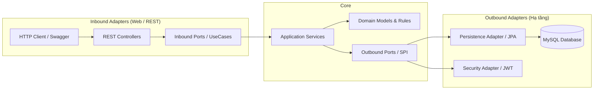

# Digital Wallet System

Hệ thống Backend RESTful API cho dịch vụ **Ví điện tử. Ứng dụng triển khai theo **Hexagonal Architecture**, đảm bảo tính độc lập giữa Business và Infrastructure.

---
## 1. Công nghệ sử dụng

- **Ngôn ngữ & Nền tảng:** Java, Spring Boot.
- **Lưu trữ & ORM:** MySQL, Spring Data JPA, Hibernate.
- **Mapper & Utilities:** MapStruct, Lombok.
- **API:** OpenAPI.
- **Kiểm thử:** JUnit, Mockito.
- **Đóng gói:** Docker.

---
## 2. Kiến trúc hệ thống

Dự án áp dụng Hexagonal Architecture: Lõi nghiệp vụ (`Domain` & `Application`) nằm ở trung tâm, không phụ thuộc vào Framework hay Database. Mọi giao tiếp của Business và Infrastructure đều thông qua **Ports** và **Adapters**.




---

## 3. Đặc tả chức năng & Danh mục API

Toàn bộ API tuân thủ chuẩn RESTful, trả về định dạng JSON chung:
```json
{
  "timestamp": "2026-10-16T17:00:00",
  "status": 200,
  "message": "Success",
  "data": { ... }
}
```

### 3.1. Xác thực & Tài khoản (`/api/v1/auth`)

| Phương thức | Endpoint | Quyền hạn | Mô tả |
| :--- | :--- | :--- | :--- |
| `POST` | `/api/v1/auth/register` | Public | Đăng ký tài khoản mới; tự động khởi tạo ví chính (số dư `0 VND`, trạng thái `ACTIVE`). |
| `POST` | `/api/v1/auth/login` | Public | Đăng nhập bằng `username` / `password`, trả về JWT Access Token (Bearer). |

### 3.2. Quản lý Ví điện tử (`/api/v1/wallets`)

| Phương thức | Endpoint | Quyền hạn | Mô tả |
| :--- | :--- | :--- | :--- |
| `GET` | `/api/v1/wallets/me` | Authenticated | Lấy thông tin ví, số ví định danh (`wallet_number`), số dư khả dụng (`balance`) và trạng thái ví. |

### 3.3. Liên kết Ngân hàng (`/api/v1/linked-banks`)

| Phương thức | Endpoint | Quyền hạn | Mô tả |
| :--- | :--- | :--- | :--- |
| `POST` | `/api/v1/linked-banks` | Authenticated | Liên kết tài khoản ngân hàng (mã hóa/che số tài khoản `account_number_masked`). |
| `GET` | `/api/v1/linked-banks` | Authenticated | Lấy danh sách các tài khoản ngân hàng đang kích hoạt (`ACTIVE`) của ví. |
| `DELETE` | `/api/v1/linked-banks/{id}` | Authenticated | Hủy liên kết tài khoản ngân hàng (Soft-delete: cập nhật trạng thái `UNLINKED`). |

### 3.4. Giao dịch Tài chính (`/api/v1/transactions`)

| Phương thức | Endpoint | Quyền hạn | Mô tả |
| :--- | :--- | :--- | :--- |
| `POST` | `/api/v1/transactions/topup` | Authenticated | Nạp tiền từ tài khoản ngân hàng liên kết vào ví. |
| `POST` | `/api/v1/transactions/withdraw` | Authenticated | Rút tiền từ ví về tài khoản ngân hàng liên kết (kiểm tra số dư khả dụng). |
| `POST` | `/api/v1/transactions/transfer` | Authenticated | Chuyển tiền nội bộ sang ví khác theo số ví (`target_wallet_number`). |
| `GET` | `/api/v1/transactions` | Authenticated | Lấy lịch sử giao dịch (nạp, rút, chuyển, nhận tiền) của ví. |

---

## 4. Cơ chế Bảo mật (Security & JWT)

- **Stateless Authentication:** Không duy trì HTTP session trên server (`SessionCreationPolicy.STATELESS`).
- **JWT Validation:** Mọi request được bảo vệ phải gửi kèm header `Authorization: Bearer <token>`. [`JwtAuthenticationFilter`](file:///Users/dllv/Documents/GitHub/SAUETDigitalWallet/digitalwallet-system/src/main/java/sa/uet/digitalwallet_system/adapter/in/security/JwtAuthenticationFilter.java) xác thực chữ ký số HMAC-SHA, nạp danh tính (`userId`) và vai trò (`ROLE_USER`).
- **Phản hồi lỗi bảo mật chuẩn hóa:**
  - `401 Unauthorized`: Trả về JSON khi thiếu hoặc JWT không hợp lệ/hết hạn.
  - `403 Forbidden`: Trả về JSON khi truy cập tài nguyên bị hạn chế quyền.
- **Biến môi trường an toàn:** JWT Secret và DB Credentials được cấu hình qua biến môi trường, có giá trị mặc định cho môi trường phát triển cục bộ (`application.properties`).

---

## 5. Hướng dẫn cài đặt & Khởi chạy

### 5.1. Yêu cầu môi trường
- **Java:** JDK 21 trở lên.
- **MySQL:** 8.0+ hoặc 9.x (port mặc định `3306`, database `digitalwallet_db`).

### 5.2. Chạy ứng dụng cục bộ (Local)

1. **Khởi tạo cơ sở dữ liệu:**
   Chạy script DDL/DML trong thư mục `digitalwallet-database/` để tạo cấu trúc bảng và dữ liệu khởi tạo.

2. **Cấu hình (Tùy chọn qua biến môi trường):**
   ```bash
   export SPRING_DATASOURCE_URL=jdbc:mysql://localhost:3306/digitalwallet_db
   export SPRING_DATASOURCE_USERNAME=root
   export SPRING_DATASOURCE_PASSWORD=your_password
   export APP_JWT_SECRET=404E635266556A586E3272357538782F413F4428472B4B6250645367566B5970
   ```

3. **Chạy ứng dụng:**
   ```bash
   cd digitalwallet-system
   ./gradlew bootRun
   ```

4. **Chạy kiểm thử:**
   ```bash
   ./gradlew test
   ```

### 5.3. Chạy bằng Docker

```bash
cd digitalwallet-system
# Build Docker image
docker build -t digitalwallet-system:latest .

# Run container
docker run -p 8080:8080 \
  -e SPRING_DATASOURCE_URL=jdbc:mysql://host.docker.internal:3306/digitalwallet_db \
  -e SPRING_DATASOURCE_USERNAME=root \
  -e SPRING_DATASOURCE_PASSWORD=your_password \
  digitalwallet-system:latest
```

---

## 6. Tài liệu API (Swagger UI)

Sau khi ứng dụng khởi chạy thành công, truy cập giao diện Swagger UI tương tác trực tiếp tại:
- **Swagger UI:** [http://localhost:8080/swagger-ui.html](http://localhost:8080/swagger-ui.html)
- **OpenAPI Schema (JSON):** [http://localhost:8080/v3/api-docs](http://localhost:8080/v3/api-docs)

> **Hướng dẫn test API được bảo vệ trên Swagger:**
> 1. Gọi `POST /api/v1/auth/login` để lấy `accessToken`.
> 2. Nhấn nút **Authorize** ở góc trên Swagger, dán token vào và chọn **Authorize**.
> 3. Thực hiện gọi các endpoint ví, ngân hàng và giao dịch.
