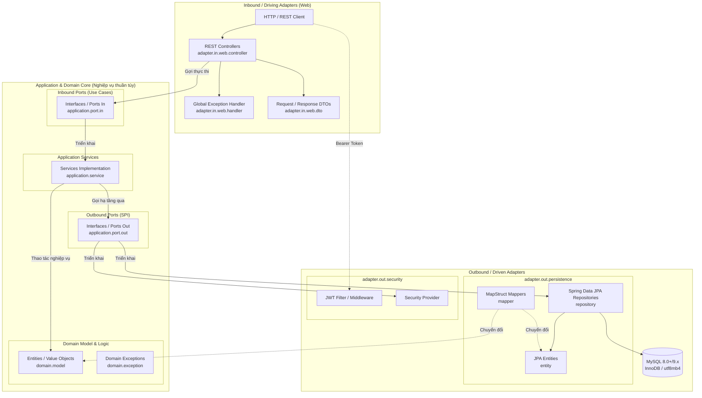
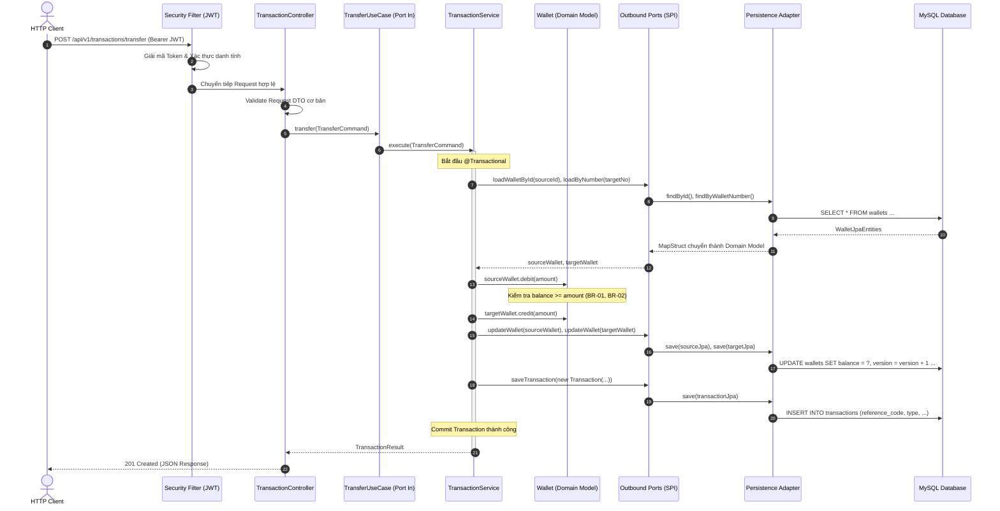

# TÀI LIỆU KIẾN TRÚC HỆ THỐNG (SYSTEM ARCHITECTURE)
## HỆ THỐNG VÍ ĐIỆN TỬ (DIGITAL WALLET) - PHA 1

---

## 1. TỔNG QUAN KIẾN TRÚC (ARCHITECTURE OVERVIEW)

### 1.1. Phong cách kiến trúc
Hệ thống **Ví điện tử (Digital Wallet)** được thiết kế và tổ chức theo **Kiến trúc Lục giác (Hexagonal Architecture / Ports and Adapters)** kết hợp tư tưởng **Domain-Driven Design (DDD) Lite**. 

Mô hình này phân tách ranh giới rõ rệt giữa:
- **Lõi nghiệp vụ (Domain & Application Core):** Nơi chứa toàn bộ tri thức, quy tắc nghiệp vụ tài chính, độc lập tuyệt đối với công nghệ hiển thị và lưu trữ.
- **Các bộ điều hợp (Adapters):** Giao tiếp với thế giới bên ngoài (Web REST API, Cơ sở dữ liệu MySQL, Cơ chế bảo mật JWT).



### 1.2. Tuân thủ tiêu chí thiết kế Pha 1
- **Phân tầng nghiêm ngặt (Strict Layering):** `API / Web Adapter` $\rightarrow$ `Application / Domain` $\rightarrow$ `Persistence Adapter`.
- **Nguyên tắc đảo ngược phụ thuộc (DIP):** Lõi nghiệp vụ (Application & Domain) nằm ở trung tâm và **hoàn toàn không import** bất kỳ thư viện nào của Web framework (Spring Web MVC) hay thư viện cơ sở dữ liệu (Spring Data JPA, Hibernate, JDBC).
- **Tính đóng gói và độc lập:** Tầng truy cập dữ liệu được giấu kín sau các Outbound Ports (Repository Interfaces), cho phép thay đổi công nghệ lưu trữ mà không làm ảnh hưởng đến luật nghiệp vụ.

---

## 2. PHÂN RÃ CÁC TẦNG & CẤU TRÚC THƯ MỤC DỰ ÁN

Toàn bộ mã nguồn backend trong `digitalwallet-system/src/main/java/sa/uet/digitalwallet_system` được tổ chức khớp 100% với cấu trúc thư mục thực tế như sau:

```
sa.uet.digitalwallet_system/
├── DigitalwalletSystemApplication.java       # Entry point Spring Boot
│
├── domain/                                    # TẦNG NGHIỆP VỤ CỐT LÕI (CORE DOMAIN)
│   ├── model/                                 # Domain Entities, Value Objects, Enums
│   └── exception/                             # Domain-specific Exceptions
│
├── application/                               # TẦNG ỨNG DỤNG (APPLICATION ORCHESTRATION)
│   ├── port/
│   │   ├── in/                                # Inbound Ports (Use Cases API cho Web)
│   │   └── out/                               # Outbound Ports (SPI cho Persistence & Security)
│   └── service/                               # Hiện thực các Use Case (Business Orchestration)
│
└── adapter/                                   # TẦNG CÁC BỘ ĐIỀU HỢP (ADAPTERS)
    ├── in/
    │   └── web/                               # Driving Adapter: Giao tiếp REST API
    │       ├── controller/                    # Spring REST Controllers
    │       ├── dto/
    │       │   ├── request/                   # DTO tiếp nhận dữ liệu từ Client
    │       │   └── response/                  # DTO trả dữ liệu chuẩn hóa
    │       └── handler/                       # Global Exception Handler (@RestControllerAdvice)
    │
    └── out/
        ├── persistence/                       # Driven Adapter: Lưu trữ CSDL
        │   ├── entity/                        # JPA Entities ánh xạ bảng CSDL
        │   ├── repository/                    # Spring Data JPA Repositories
        │   └── mapper/                        # MapStruct (Domain Model <-> JPA Entity)
        └── security/                          # Driven Adapter: Xác thực JWT & Password Hasher
```

### 2.1. Tầng Domain (`sa.uet.digitalwallet_system.domain`)
- **Vai trò:** Trung tâm của hệ thống, chứa các thực thể nghiệp vụ thuần túy (POJO) và các quy tắc bất biến.
- **Thành phần:**
  - `model`: 
    - Thực thể: `User`, `Wallet`, `LinkedBankAccount`, `Transaction`.
    - Trạng thái / Enums: `WalletStatus` (`ACTIVE`, `FROZEN`, `CLOSED`), `BankAccountStatus` (`ACTIVE`, `UNLINKED`), `TransactionType` (`TRANSFER`, `TOPUP`, `WITHDRAW`).
  - `exception`: Các ngoại lệ nghiệp vụ như `InsufficientBalanceException`, `WalletInactiveException`, `DuplicateReferenceCodeException`...
- **Ràng buộc công nghệ:** Java 21 thuần (Plain Java), không có annotation của Spring Boot, Hibernate hay JPA.

### 2.2. Tầng Application (`sa.uet.digitalwallet_system.application`)
- **Vai trò:** Điều phối luồng nghiệp vụ (Business Orchestration), triển khai các kịch bản sử dụng (Use Cases) của hệ thống.
- **Thành phần:**
  - `port.in`: Các interface đặc tả hành động mà Client có thể yêu cầu, ví dụ:
    - `RegisterUseCase`, `LoginUseCase`
    - `GetWalletUseCase`
    - `LinkBankAccountUseCase`, `UnlinkBankAccountUseCase`
    - `TopupUseCase`, `WithdrawUseCase`, `TransferUseCase`, `GetTransactionsUseCase`
  - `port.out`: Các interface mà lõi nghiệp vụ đòi hỏi hạ tầng phải đáp ứng (SPI - Service Provider Interface):
    - `LoadUserPort`, `SaveUserPort`
    - `LoadWalletPort`, `UpdateWalletPort`
    - `LoadBankAccountPort`, `UpdateBankAccountPort`
    - `SaveTransactionPort`, `LoadTransactionPort`
    - `TokenProviderPort`, `PasswordEncoderPort`
  - `service`: Các lớp hiện thực Inbound Ports (ví dụ: `WalletService`, `TransactionService`, `AuthService`). Quản lý giao dịch nguyên tử (`@Transactional`), gọi Domain Model để xử lý nghiệp vụ, lưu lại kết quả qua Outbound Ports.

### 2.3. Tầng Web Adapter (`sa.uet.digitalwallet_system.adapter.in.web`)
- **Vai trò:** Đóng vai trò Driving Adapter, tiếp nhận yêu cầu HTTP/JSON từ Client, xác thực sơ bộ và chuyển tiếp tới Inbound Port tương ứng.
- **Thành phần:**
  - `controller`: Các `@RestController` (ví dụ: `AuthController`, `WalletController`, `LinkedBankController`, `TransactionController`) ánh xạ URL `/api/v1/**`.
  - `dto.request` / `dto.response`: Các đối tượng đóng gói dữ liệu truyền nhận độc lập với Domain Model.
  - `handler`: `GlobalExceptionHandler` sử dụng `@RestControllerAdvice` để bắt các Exception (cả Domain lẫn System) và chuyển đổi thành cấu trúc phản hồi lỗi chuẩn `{ "success": false, "errorCode": "...", "message": "..." }`.

### 2.4. Tầng Persistence Adapter (`sa.uet.digitalwallet_system.adapter.out.persistence`)
- **Vai trò:** Đóng vai trò Driven Adapter, hiện thực hóa các Outbound Ports liên quan đến CSDL MySQL.
- **Thành phần:**
  - `entity`: Các lớp JPA Entity (`UserJpaEntity`, `WalletJpaEntity`, `LinkedBankAccountJpaEntity`, `TransactionJpaEntity`) ánh xạ trực tiếp với bảng trong file `digitalwallet_p1.sql`.
  - `repository`: Các interface kế thừa `JpaRepository` của Spring Data JPA.
  - `mapper`: Thư viện MapStruct (`WalletMapper`, `TransactionMapper`...) chịu trách nhiệm chuyển đổi 2 chiều giữa JPA Entity và Domain Model, ngăn ngừa việc rò rỉ JPA Entity vào sâu bên trong lõi nghiệp vụ.

### 2.5. Tầng Security Adapter (`sa.uet.digitalwallet_system.adapter.out.security`)
- **Vai trò:** Xử lý cơ chế băm mật khẩu (BCrypt) và ký/xác thực JSON Web Token (JWT).
- **Cơ chế:** Hiện thực hóa các Outbound Ports như `TokenProviderPort`, `PasswordEncoderPort`.

---

## 3. LUỒNG XỬ LÝ DỮ LIỆU ĐIỂN HÌNH (DATA FLOW)

Dưới đây là sơ đồ tuần tự thể hiện sự phối hợp giữa các tầng qua giao dịch Chuyển tiền (`POST /api/v1/transactions/transfer`):



---

## 4. BẢO MẬT HỆ THỐNG & CƠ CHẾ XÁC THỰC (SECURITY)

### 4.1. Nguyên tắc triển khai tập trung
Hệ thống tuân thủ nghiêm ngặt yêu cầu đề bài: **Xác thực qua Middleware/Filter của framework, không viết lặp trong từng endpoint.**

- **Bộ lọc tập trung (`OncePerRequestFilter`):**
  - Chặn mọi request HTTP trước khi đi tới Controller.
  - Trích xuất header `Authorization: Bearer <token>`.
  - Kiểm tra tính toàn vẹn và thời hạn của JWT.
  - Nạp thông tin định danh người dùng vào `SecurityContextHolder`.
- **Cấu hình phân quyền tập trung (Security Filter Chain):**
  - **Public Endpoints (Không cần Token):**
    - `POST /api/v1/auth/register`: Đăng ký tài khoản.
    - `POST /api/v1/auth/login`: Đăng nhập lấy Token.
    - `GET /api-docs/**`, `GET /swagger-ui/**`, `GET /swagger-ui.html`: Tài liệu kỹ thuật OpenAPI.
  - **Protected Endpoints (Bắt buộc Token hợp lệ):**
    - `GET /api/v1/wallets/me` *(Thỏa mãn GET cần xác thực)*.
    - `POST /api/v1/linked-banks`, `DELETE /api/v1/linked-banks/{id}` *(Thỏa mãn POST & DELETE cần xác thực)*.
    - `POST /api/v1/transactions/**`, `GET /api/v1/transactions`.

---

## 5. THIẾT KẾ DỮ LIỆU & NGUYÊN TẮC BẢO TOÀN TÀI CHÍNH

Hệ thống kết nối trực tiếp với CSDL MySQL (được đặc tả chi tiết tại [dbanalysis.md](file:///Users/dllv/Documents/GitHub/SAUETDigitalWallet/digitalwallet-docs/dbanalysis.md)) và tuân thủ các nguyên tắc thiết kế kỹ thuật:

1. **Toàn vẹn giao dịch (ACID & @Transactional):**
   - Mọi thao tác biến động số dư (nạp, rút, chuyển) và ghi sổ cái đều được gói gọn trong một Database Transaction duy nhất. Bất kỳ lỗi logic nào phát sinh đều kích hoạt rollback tức thì.
2. **Khóa lạc quan (Optimistic Locking):**
   - Cột `version` (kiểu `BIGINT`) trên bảng `wallets` được JPA ánh xạ qua `@Version`, tự động phát hiện và ngăn chặn tình trạng ghi đè đồng thời (Lost Updates / Race Condition) khi có nhiều giao dịch xử lý cùng một lúc.
3. **Phòng thủ đa tầng (Defense in Depth):**
   - Logic kiểm tra số dư được thực hiện tại **Domain Model** (`balance >= amount`).
   - Tầng CSDL có ràng buộc cứng `CHECK (balance >= 0)`. Nếu ứng dụng xảy ra lỗi logic, Database Engine sẽ từ chối lệnh và tự động ngắt kết nối.
4. **Sổ cái bất biến (Immutable Ledger):**
   - Bảng `transactions` chỉ hỗ trợ thao tác ghi thêm (`INSERT`), không cung cấp cơ chế cập nhật (`UPDATE`) hoặc xóa (`DELETE`).

---

## 6. ĐÓNG GÓI & MÔI TRƯỜNG TRIỂN KHAI (DEPLOYMENT & CONTAINERIZATION)

### 6.1. Đóng gói Dockerfile đa tầng (Multi-Stage Build)
Hệ thống sử dụng file [Dockerfile](file:///Users/dllv/Documents/GitHub/SAUETDigitalWallet/digitalwallet-system/Dockerfile) với 2 giai đoạn tách biệt nhằm tối ưu hóa dung lượng image và bảo mật vận hành:

- **Stage 1 (Builder):**
  - Base Image: `eclipse-temurin:21-jdk-alpine`.
  - Tận dụng cơ chế layer caching của Docker cho Gradle wrapper và các dependencies (`./gradlew dependencies`).
  - Biên dịch mã nguồn và đóng gói file thực thi `bootJar` (bỏ qua bước test khi build image để tăng tốc độ).
- **Stage 2 (Runtime):**
  - Base Image: `eclipse-temurin:21-jre-alpine` (chỉ chứa môi trường JRE siêu nhẹ, loại bỏ toàn bộ công cụ build JDK).
  - Tạo nhóm và người dùng không có đặc quyền root (`appuser:appgroup`) để thực thi ứng dụng bên trong container, tăng cường an toàn thông tin.
  - Sao chép file `.jar` từ Stage 1 sang Stage 2.
  - Cổng lắng nghe: `8080`.

### 6.2. Tối ưu hóa JVM cho môi trường giới hạn (Kaggle CPU)
Tại lệnh khởi chạy container (`ENTRYPOINT`), hệ thống được cấu hình sẵn các tham số JVM tối ưu cho môi trường tài nguyên hạn chế:
- `-XX:+UseContainerSupport`: Tự động nhận diện chính xác giới hạn CPU và RAM do cgroups của container cấp phát.
- `-XX:MaxRAMPercentage=75.0`: Chỉ định bộ nhớ Heap tối đa bằng 75% RAM được cấp phát cho container, dự phòng 25% cho Metaspace và OS native memory, ngăn chặn sự cố OOM Killer.
- `-XX:+UseG1GC`: Sử dụng Garbage Collector hiện đại, tối ưu độ trễ và thông lượng thu gom rác.
- `-XX:+OptimizeStringConcat`: Tối ưu hóa xử lý chuỗi và JSON.
- `-Djava.security.egd=file:/dev/./urandom`: Tăng tốc độ sinh chuỗi ngẫu nhiên bảo mật (UUID, JWT) mà không bị nghẽn entropy hệ thống.

---

## 7. BẢNG ĐỐI CHIẾU TIÊU CHÍ KỸ THUẬT PHA 1

| Tiêu chuẩn yêu cầu | Hiện thực trong Kiến trúc | Trạng thái |
| :--- | :--- | :---: |
| **REST API qua JSON** | Giao tiếp JSON chuẩn hóa, `@RestController`, Base URL `/api/v1` | **Đạt** |
| **Đủ POST, GET, DELETE** | `POST` (Auth, Trans, Bank), `GET` (Wallet, Trans, Bank), `DELETE` (Bank) | **Đạt** |
| **Tài liệu API OpenAPI** | Tích hợp `springdoc-openapi` tại `/api-docs` và `/swagger-ui.html` | **Đạt** |
| **Phân tầng kiến trúc sạch** | Hexagonal Architecture: API $\rightarrow$ Application/Domain $\rightarrow$ Persistence; Domain độc lập hoàn toàn với Web và DB | **Đạt** |
| **Truy cập dữ liệu qua Repository** | Spring Data JPA Repository + MapStruct Data Mapper | **Đạt** |
| **Bảo mật & Middleware** | JWT Filter (`OncePerRequestFilter`) tập trung, bảo vệ các endpoint | **Đạt** |
| **Đóng gói Docker** | Multi-stage Dockerfile (Temurin JDK 21 Alpine $\rightarrow$ JRE 21 Alpine) | **Đạt** |
| **Tối ưu kiểm thử Kaggle CPU** | Kiến trúc phi trạng thái (Stateless), JVM container flags tối ưu tài nguyên | **Đạt** |
