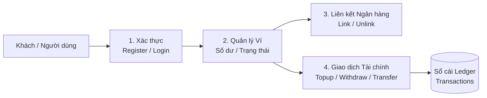

# TÀI LIỆU ĐẶC TẢ YÊU CẦU NGHIỆP VỤ (BUSINESS REQUIREMENTS)
## HỆ THỐNG VÍ ĐIỆN TỬ (DIGITAL WALLET) - PHA 1

---

## 1. GIỚI THIỆU & MỤC TIÊU PHA 1

### 1.1. Bối cảnh & Nghiệp vụ lựa chọn
Hệ thống được xây dựng phục vụ nghiệp vụ **Ví điện tử (Digital Wallet)**, cho phép người dùng mở tài khoản ví, quản lý số dư, liên kết tài khoản ngân hàng và thực hiện các giao dịch nạp tiền, rút tiền, chuyển tiền nội bộ nhanh chóng, an toàn.

### 1.2. Mục tiêu triển khai Pha 1
Đáp ứng đầy đủ các tiêu chí kỹ thuật và nghiệp vụ cốt lõi của Pha 1:
- **Chuẩn giao tiếp:** RESTful API chuẩn hóa, trao đổi dữ liệu định dạng JSON.
- **Tập phương thức HTTP:** Cung cấp đầy đủ các method bắt buộc: `POST`, `GET`, `DELETE`.
- **Tài liệu hóa API:** Tích hợp OpenAPI / Swagger UI tự động (`/swagger-ui.html`).
- **Kiến trúc phân tầng sạch (Hexagonal / Clean Architecture):**
  - Tách bạch: `API / Web Adapter` $\rightarrow$ `Application Core (Nghiệp vụ)` $\rightarrow$ `Persistence Adapter (Truy cập dữ liệu)`.
  - Tầng nghiệp vụ độc lập, không phụ thuộc framework web hay thư viện CSDL.
  - Truy cập dữ liệu qua Repository / Data Mapper.
- **Bảo mật & Phân quyền:**
  - Hỗ trợ đăng ký và đăng nhập xác thực bằng JWT Token.
  - Bảo vệ các endpoint nhạy cảm (ít nhất 1 GET, 1 POST cần xác thực).
  - Cơ chế xác thực tập trung qua Security Filter Middleware, không viết lặp tại controller.
- **Đóng gói & Kiểm thử:**
  - Cung cấp `Dockerfile` chuẩn đa tầng (Multi-stage build).
  - Hệ thống nhẹ, sẵn sàng chạy và kiểm thử tải trên môi trường Kaggle CPU.

---

## 2. CÁC TÁC NHÂN HỆ THỐNG (ACTORS)

Trong Pha 1, hệ thống tập trung vào nghiệp vụ người dùng cơ bản và **chưa cần vai trò Admin**, chỉ gồm 2 tác nhân chính:

| Tác nhân | Quyền hạn | Mô tả vai trò |
| :--- | :--- | :--- |
| **Guest (Khách vãng lai)** | Chưa xác thực | Có thể thực hiện đăng ký tài khoản (`register`) và đăng nhập hệ thống (`login`). |
| **User (Người dùng ví)** | Đã xác thực (JWT) | Chủ sở hữu ví: xem thông tin ví & số dư, liên kết/hủy ngân hàng, nạp/rút/chuyển tiền và tra cứu lịch sử giao dịch của chính mình. |

*(Lưu ý: Trường `role` trong CSDL mặc định gán `ROLE_USER` để đảm bảo tính mở rộng cho các pha sau mà không cần triển khai logic phân quyền Admin phức tạp ở Pha 1).*

---

## 3. CÁC CHỨC NĂNG NGHIỆP VỤ CỐT LÕI

Hệ thống tập trung vào 4 nhóm nghiệp vụ chính tương ứng với mô hình CSDL trong [dbanalysis.md](file:///Users/dllv/Documents/GitHub/SAUETDigitalWallet/digitalwallet-docs/dbanalysis.md):

### 3.1. Nghiệp vụ Xác thực & Đăng nhập (Authentication)
- **Đăng ký tài khoản (`POST /api/v1/auth/register`):**
  - Người dùng cung cấp `username`, `password`, `full_name`, `email`.
  - Hệ thống kiểm tra trùng lặp `username` hoặc `email`.
  - Mật khẩu được mã hóa an toàn (BCrypt).
  - Tự động tạo 1 ví điện tử chính (`wallets`) tương ứng cho người dùng với số dư ban đầu là `0 VND`, trạng thái `ACTIVE`.
- **Đăng nhập (`POST /api/v1/auth/login`):**
  - Xác thực thông tin đăng nhập, trả về JWT Access Token để người dùng gắn vào Header `Authorization: Bearer <token>` cho các yêu cầu kế tiếp.

### 3.2. Nghiệp vụ Quản lý Ví điện tử (Wallet Management)
- **Xem thông tin ví & số dư (`GET /api/v1/wallets/me`):**
  - **Yêu cầu xác thực (Authenticated).**
  - Trả về số ví (`wallet_number`), số dư khả dụng tức thời (`balance`), và trạng thái ví (`ACTIVE`, `FROZEN`, `CLOSED`).

### 3.3. Nghiệp vụ Liên kết Tài khoản Ngân hàng (Linked Bank Accounts)
- **Liên kết tài khoản ngân hàng (`POST /api/v1/linked-banks`):**
  - **Yêu cầu xác thực (Authenticated).**
  - Người dùng khai báo mã ngân hàng (`bank_code`), tên ngân hàng (`bank_name`), số tài khoản và tên chủ thẻ (`holder_name`).
  - Hệ thống lưu trữ số tài khoản dưới dạng mặt nạ che số (`account_number_masked`, ví dụ: `******6789`) để bảo vệ dữ liệu nhạy cảm. Trạng thái mặc định: `ACTIVE`.
- **Lấy danh sách ngân hàng liên kết (`GET /api/v1/linked-banks`):**
  - **Yêu cầu xác thực (Authenticated).**
  - Trả về danh sách tài khoản ngân hàng đang kích hoạt (`status = 'ACTIVE'`) của ví người dùng hiện tại.
- **Hủy liên kết tài khoản ngân hàng (`DELETE /api/v1/linked-banks/{id}`):**
  - **Yêu cầu xác thực (Authenticated).**
  - Đáp ứng yêu cầu có phương thức `DELETE` của Pha 1.
  - Sử dụng cơ chế xóa mềm (Soft Delete): Đổi trạng thái sang `UNLINKED` và cập nhật dấu thời gian `unlinked_at`, không xóa vật lý khỏi CSDL để bảo toàn liên kết với các giao dịch trong quá khứ.

### 3.4. Nghiệp vụ Giao dịch Tài chính (Financial Transactions)
Hệ thống ghi nhận mọi biến động vào sổ cái bất biến `transactions` (chỉ thêm mới, không sửa/xóa):
- **Nạp tiền vào ví (`POST /api/v1/transactions/topup`):**
  - Nguồn tiền: Tài khoản ngân hàng liên kết (`linked_bank_account_id`).
  - Đích: Ví người dùng (`target_wallet_id`).
  - Cộng số dư ví, tạo bản ghi giao dịch loại `TOPUP`.
- **Rút tiền về ngân hàng (`POST /api/v1/transactions/withdraw`):**
  - Nguồn tiền: Ví người dùng (`source_wallet_id`).
  - Đích: Tài khoản ngân hàng liên kết (`linked_bank_account_id`).
  - Kiểm tra điều kiện: Ví ở trạng thái `ACTIVE` và số dư $\ge$ số tiền rút.
  - Trừ số dư ví, tạo bản ghi giao dịch loại `WITHDRAW`.
- **Chuyển tiền ví - ví (`POST /api/v1/transactions/transfer`):**
  - Nguồn tiền: Ví người chuyển (`source_wallet_id`).
  - Đích: Ví người nhận qua số ví (`target_wallet_id`).
  - Kiểm tra điều kiện: Ví gửi và ví nhận đều `ACTIVE`, ví gửi khác ví nhận, số dư ví gửi $\ge$ số tiền chuyển.
  - Thực thi atomic transaction: Trừ số dư ví nguồn, cộng số dư ví đích, tạo bản ghi giao dịch loại `TRANSFER`.
- **Xem lịch sử giao dịch (`GET /api/v1/transactions`):**
  - **Yêu cầu xác thực (Authenticated).**
  - Truy vấn danh sách các giao dịch phát sinh liên quan đến ví (nguồn hoặc đích), sắp xếp thời gian mới nhất.

---

## 4. QUY TẮC NGHIỆP VỤ & TÍNH TOÀN VẸN TÀI CHÍNH (BUSINESS RULES)

| Mã quy tắc | Quy tắc nghiệp vụ | Giải thích & Triển khai kỹ thuật |
| :--- | :--- | :--- |
| **BR-01** | **Tiền tệ nguyên số (Integer Currency)** | Đơn vị tiền tệ chuẩn là **VND**, kiểu dữ liệu `BIGINT`. Không dùng số thực (Float/Double) nhằm loại trừ sai số làm tròn. Số tiền giao dịch phải $> 0$. |
| **BR-02** | **Không cho phép số dư âm** | Ràng buộc số dư ví `balance >= 0`. Mọi hành vi rút/chuyển vượt quá số dư sẽ bị chặn ngay tại tầng nghiệp vụ và bảo vệ bởi CSDL `chk_wallets_balance`. |
| **BR-03** | **Sổ cái bất biến (Append-only Ledger)** | Bảng `transactions` là lịch sử đối soát bất biến. Không cung cấp API hay thao tác `UPDATE` / `DELETE` trên bảng giao dịch. |
| **BR-04** | **Bảo toàn dữ liệu (Zero Cascade)** | Khóa ngoại giữa bảng không dùng `CASCADE DELETE`. Khi xóa liên kết ngân hàng, chỉ chuyển trạng thái `UNLINKED` (xóa mềm). |
| **BR-05** | **Chống xung đột đồng thời** | Áp dụng khóa lạc quan (`@Version` trên `wallets`) kết hợp Transaction ACID của CSDL để ngăn chặn xung đột khi nhiều giao dịch cập nhật số dư cùng lúc (Race condition / Double-spending). |
| **BR-06** | **Chống trùng lặp lệnh (Idempotency)** | Mỗi giao dịch được định danh bằng một mã tham chiếu duy nhất `reference_code` (UUID v4) ngăn chặn việc người dùng bấm gửi nhiều lần gây lặp giao dịch. |

---

## 5. ĐẶC TẢ TẬP REST API (MAPPING PHA 1)

Dưới đây là danh mục API đáp ứng đầy đủ các tiêu chuẩn phương thức (`POST`, `GET`, `DELETE`) và xác thực bảo mật của Pha 1:

| STT | Phương thức | Endpoint | Yêu cầu Auth | Mô tả chức năng |
| :---: | :---: | :--- | :---: | :--- |
| 1 | `POST` | `/api/v1/auth/register` | Public | Đăng ký tài khoản người dùng và tự động tạo ví |
| 2 | `POST` | `/api/v1/auth/login` | Public | Đăng nhập hệ thống, trả về JWT Access Token |
| 3 | `GET` | `/api/v1/wallets/me` | **Bearer JWT** | Xem thông tin ví và số dư hiện tại *(Thỏa mãn GET có xác thực)* |
| 4 | `POST` | `/api/v1/linked-banks` | **Bearer JWT** | Liên kết tài khoản ngân hàng mới *(Thỏa mãn POST có xác thực)* |
| 5 | `GET` | `/api/v1/linked-banks` | **Bearer JWT** | Lấy danh sách các tài khoản ngân hàng đang liên kết |
| 6 | `DELETE` | `/api/v1/linked-banks/{id}` | **Bearer JWT** | Hủy liên kết tài khoản ngân hàng *(Thỏa mãn method DELETE)* |
| 7 | `POST` | `/api/v1/transactions/topup` | **Bearer JWT** | Nạp tiền từ ngân hàng vào ví |
| 8 | `POST` | `/api/v1/transactions/withdraw` | **Bearer JWT** | Rút tiền từ ví về ngân hàng liên kết |
| 9 | `POST` | `/api/v1/transactions/transfer` | **Bearer JWT** | Chuyển tiền từ ví sang ví khác |
| 10 | `GET` | `/api/v1/transactions` | **Bearer JWT** | Tra cứu lịch sử các giao dịch của ví |
| 11 | `GET` | `/v3/api-docs`, `/swagger-ui.html` | Public | Tài liệu kỹ thuật API trực quan (OpenAPI/Swagger) |

---