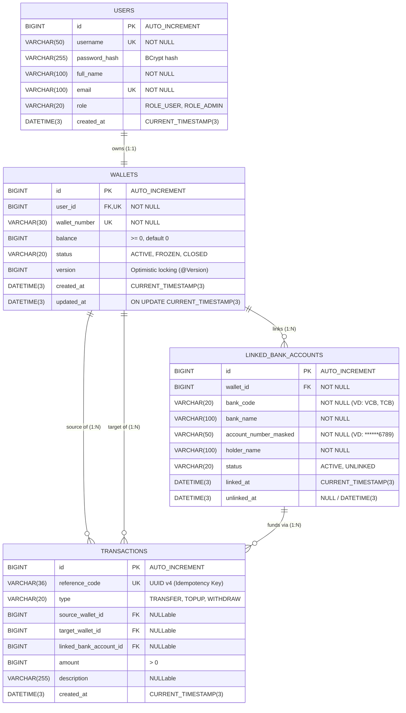

# TÀI LIỆU PHÂN TÍCH VÀ THIẾT KẾ CƠ SỞ DỮ LIỆU
## HỆ THỐNG VÍ ĐIỆN TỬ (DIGITAL WALLET) - PHA 1

---

## 1. TỔNG QUAN HỆ THỐNG & NGUYÊN TẮC THIẾT KẾ NỀN TẢNG

### 1.1. Phạm vi nghiệp vụ (Scope)
Hệ thống Cơ sở dữ liệu (CSDL) Ví điện tử Digital Wallet (Pha 1) được thiết kế tập trung vào các nghiệp vụ cốt lõi:
1. **Quản lý danh tính người dùng (Users):** Đăng ký, xác thực đăng nhập, phân quyền cơ bản (`ROLE_USER`, `ROLE_ADMIN`).
2. **Quản lý ví tài khoản (Wallets):** Mỗi người dùng sở hữu 1 ví chính, lưu trữ số dư tức thời, kiểm soát trạng thái ví (`ACTIVE`, `FROZEN`, `CLOSED`).
3. **Liên kết tài khoản ngân hàng (Linked Bank Accounts):** Quản lý liên kết/hủy liên kết tài khoản ngân hàng (xóa mềm).
4. **Sổ cái giao dịch bất biến (Transactions Ledger):** Xử lý 3 nghiệp vụ tài chính nền tảng:
   - **Nạp tiền (TOPUP):** Ngân hàng liên kết $\rightarrow$ Ví.
   - **Rút tiền (WITHDRAW):** Ví $\rightarrow$ Ngân hàng liên kết.
   - **Chuyển tiền (TRANSFER):** Ví $\rightarrow$ Ví khác.

### 1.2. Thông số kỹ thuật môi trường
- **Hệ quản trị CSDL:** MySQL 8.0+ / 9.x.
- **Storage Engine:** `InnoDB` (bắt buộc: hỗ trợ chuẩn giao dịch ACID, Row-level Locking, Foreign Keys, hồi phục khi sự cố Crash Recovery).
- **Bộ mã ký tự (Charset & Collation):** `utf8mb4` kết hợp `utf8mb4_unicode_ci` (hỗ trợ đầy đủ tiếng Việt có dấu, ký tự quốc tế, emoji và bảo đảm độ chính xác khi so khớp văn bản).

### 1.3. Các nguyên lý thiết kế tài chính tối quan trọng
1. **Nguyên tắc tiền tệ nguyên số (Integer Currency Representation):**
   - Đơn vị tiền tệ chuẩn là **Việt Nam Đồng (VND)**.
   - Kiểu dữ liệu sử dụng là `BIGINT` (đơn vị: đồng).
   - **Tuyệt đối không dùng `FLOAT` hoặc `DOUBLE`:** Tránh hoàn toàn lỗi sai số làm tròn dấu phẩy động (IEEE 754 floating-point rounding errors). `BIGINT` có giá trị tối đa lên tới $9 \times 10^{18}$, hoàn toàn đáp ứng quy mô giao dịch tài chính hàng ngàn tỷ đồng mà không bao giờ lo tràn số.
2. **Nguyên tắc không xóa lan truyền (Zero Cascade Policy):**
   - Toàn bộ các khóa ngoại (Foreign Keys) sử dụng hành vi mặc định `RESTRICT` (hoặc `NO ACTION`), **không sử dụng `ON DELETE CASCADE` hay `ON UPDATE CASCADE`**.
   - *Lý do kỹ thuật:*
     - MySQL không cho phép ràng buộc `CHECK` trên các cột có cấu hình cascade foreign key.
     - Trong hệ thống tài chính, dữ liệu lịch sử kế toán/giao dịch không bao giờ được phép tự động bị xóa theo cascading delete khi user hay wallet bị xóa.
3. **Nguyên tắc sổ cái bất biến (Immutable / Append-only Ledger):**
   - Bảng `transactions` đóng vai trò là sổ cái ghi nhận biến động dòng tiền: **Chỉ ghi mới (`INSERT`), không bao giờ cập nhật (`UPDATE`) hoặc xóa (`DELETE`)**.
4. **Độ phân giải thời gian mili-giây (`DATETIME(3)`):**
   - Tất cả dấu thời gian (`created_at`, `updated_at`, `linked_at`) đều dùng `DATETIME(3)` để phân biệt chính xác thứ tự giao dịch phát sinh gần như đồng thời trong cùng một giây.

---

## 2. MÔ HÌNH THỰC THỂ - MỐI QUAN HỆ (ERD)

---

## 3. TỪ ĐIỂN DỮ LIỆU & PHÂN TÍCH CHI TIẾT CÁC BẢNG

### 3.1. Bảng `users` (Danh tính & Đăng nhập)
Lưu trữ thông tin tài khoản người dùng, chứng thực danh tính và phân quyền truy cập.

| Tên cột | Kiểu dữ liệu | Nullable | Mặc định | Khóa / Ràng buộc | Ý nghĩa nghiệp vụ |
| :--- | :--- | :---: | :--- | :--- | :--- |
| `id` | `BIGINT` | NO | `AUTO_INCREMENT` | `PRIMARY KEY` | Định danh duy nhất của người dùng. |
| `username` | `VARCHAR(50)` | NO | Không | `UNIQUE (uq_users_username)` | Tên đăng nhập người dùng (duy nhất trên toàn hệ thống). |
| `password_hash` | `VARCHAR(255)` | NO | Không | Không | Mật khẩu băm (Khuyến nghị chuẩn BCrypt/Argon2id, độ dài 60-128 ký tự). |
| `full_name` | `VARCHAR(100)` | NO | Không | Không | Họ và tên đầy đủ của chủ tài khoản. |
| `email` | `VARCHAR(100)` | NO | Không | `UNIQUE (uq_users_email)` | Email đăng ký và nhận thông báo biến động số dư. |
| `role` | `VARCHAR(20)` | NO | `'ROLE_USER'` | `CHECK (role IN ('ROLE_USER', 'ROLE_ADMIN'))` | Vai trò hệ thống để kiểm soát truy cập (RBAC). |
| `created_at` | `DATETIME(3)` | NO | `CURRENT_TIMESTAMP(3)` | Không | Thời điểm tạo tài khoản (chính xác đến mili-giây). |

#### Chi tiết Ràng buộc & Chỉ mục:
- **`uq_users_username` & `uq_users_email`:** Đảm bảo tính độc nhất tuyệt đối, ngăn ngừa việc 1 email hoặc username được đăng ký nhiều lần; đồng thời MySQL tự động tạo B-Tree Index giúp tăng tốc tối đa tác vụ tìm kiếm khi đăng nhập.
- **`chk_users_role`:** Kiểm soát giá trị hợp lệ của cột `role` trực tiếp tại tầng CSDL, ngăn chặn dữ liệu bẩn từ lỗi code backend.

---

### 3.2. Bảng `wallets` (Ví điện tử & Số dư tức thời)
Quản lý tài khoản ví điện tử của từng khách hàng, nắm giữ số dư hiện tại và cơ chế khóa phiên làm việc chống xung đột dữ liệu.

| Tên cột | Kiểu dữ liệu | Nullable | Mặc định | Khóa / Ràng buộc | Ý nghĩa nghiệp vụ |
| :--- | :--- | :---: | :--- | :--- | :--- |
| `id` | `BIGINT` | NO | `AUTO_INCREMENT` | `PRIMARY KEY` | Định danh duy nhất của ví. |
| `user_id` | `BIGINT` | NO | Không | `FK -> users(id)`, `UNIQUE (uq_wallets_user)` | Người dùng sở hữu ví (tỉ lệ 1:1 trong Pha 1). |
| `wallet_number` | `VARCHAR(30)` | NO | Không | `UNIQUE (uq_wallets_number)` | Mã định danh số ví công khai để nhận chuyển tiền (VD: 10-12 số ngẫu nhiên/số điện thoại). |
| `balance` | `BIGINT` | NO | `0` | `CHECK (balance >= 0)` | Số dư khả dụng hiện tại (Đơn vị: VNĐ). |
| `status` | `VARCHAR(20)` | NO | `'ACTIVE'` | `CHECK (status IN ('ACTIVE', 'FROZEN', 'CLOSED'))` | Trạng thái hoạt động của ví. |
| `version` | `BIGINT` | NO | `0` | Không | Phiên bản phục vụ **Khóa lạc quan (Optimistic Locking)** của JPA/Hibernate. |
| `created_at` | `DATETIME(3)` | NO | `CURRENT_TIMESTAMP(3)` | Không | Thời điểm tạo ví. |
| `updated_at` | `DATETIME(3)` | NO | `CURRENT_TIMESTAMP(3) ON UPDATE` | Không | Thời điểm có biến động số dư hoặc trạng thái ví gần nhất. |

#### Chi tiết Ràng buộc & Chỉ mục:
- **`uq_wallets_user`:** Thiết lập quan hệ nghiêm ngặt **1 User = 1 Ví**. Nếu trong tương lai muốn mở rộng 1 User có nhiều ví (ví dụ: ví thanh toán, ví tiết kiệm), chỉ cần `ALTER TABLE DROP CONSTRAINT uq_wallets_user`.
- **`chk_wallets_balance (balance >= 0)`:** **Ràng buộc an toàn phòng thủ tối thượng.** Bất kỳ giao dịch chuyển tiền hoặc rút tiền nào nếu tầng ứng dụng tính toán sai sót dẫn đến số dư bị âm, MySQL Engine sẽ chủ động hủy bỏ (Abort) câu lệnh và Rollback transaction ngay lập tức.
- **`chk_wallets_status`:** Đảm bảo chỉ nhận 3 trạng thái chuẩn:
  - `ACTIVE`: Hoạt động bình thường.
  - `FROZEN`: Bị đóng băng (tạm ngưng nạp/rút/chuyển khi phát hiện gian lận hoặc yêu cầu của người dùng).
  - `CLOSED`: Đã đóng vĩnh viễn.

---

### 3.3. Bảng `linked_bank_accounts` (Tài khoản ngân hàng liên kết)
Lưu trữ thông tin liên kết ngân hàng phục vụ nạp và rút tiền. Hỗ trợ mô hình xóa mềm (Soft Delete).

| Tên cột | Kiểu dữ liệu | Nullable | Mặc định | Khóa / Ràng buộc | Ý nghĩa nghiệp vụ |
| :--- | :--- | :---: | :--- | :--- | :--- |
| `id` | `BIGINT` | NO | `AUTO_INCREMENT` | `PRIMARY KEY` | Định danh bản ghi liên kết. |
| `wallet_id` | `BIGINT` | NO | Không | `FK -> wallets(id)` | Ví liên kết với tài khoản ngân hàng này. |
| `bank_code` | `VARCHAR(20)` | NO | Không | Không | Mã định danh ngân hàng theo chuẩn Napas/VietQR (VD: `VCB`, `TCB`, `MB`, `VIB`). |
| `bank_name` | `VARCHAR(100)` | NO | Không | Không | Tên hiển thị của ngân hàng (VD: "Ngân hàng Ngoại thương Việt Nam"). |
| `account_number_masked` | `VARCHAR(50)` | NO | Không | Không | Số tài khoản ngân hàng đã được che một phần (VD: `******6789`) để bảo vệ dữ liệu nhạy cảm. |
| `holder_name` | `VARCHAR(100)` | NO | Không | Không | Họ tên chủ tài khoản ngân hàng (viết hoa không dấu). |
| `status` | `VARCHAR(20)` | NO | `'ACTIVE'` | `CHECK (status IN ('ACTIVE', 'UNLINKED'))` | Trạng thái liên kết. |
| `linked_at` | `DATETIME(3)` | NO | `CURRENT_TIMESTAMP(3)` | Không | Thời điểm liên kết thành công. |
| `unlinked_at` | `DATETIME(3)` | YES | `NULL` | Không | Thời điểm hủy liên kết ngân hàng. |

#### Chi tiết Ràng buộc & Chỉ mục:
- **Ràng buộc vòng đời xóa mềm (`chk_linked_unlinked_at`):**
  $$\text{CHECK } \big( (\text{status} = \text{'ACTIVE'} \land \text{unlinked\_at IS NULL}) \lor (\text{status} = \text{'UNLINKED'} \land \text{unlinked\_at IS NOT NULL}) \big)$$
  Ngăn chặn trạng thái mâu thuẫn: Không thể có trường hợp tài khoản đã hủy liên kết (`UNLINKED`) mà `unlinked_at` lại là `NULL`, hoặc tài khoản đang kích hoạt (`ACTIVE`) mà lại có ngày hủy.
- **Chỉ mục kết hợp (`idx_linked_wallet_status` on `(wallet_id, status)`):**
  Tối ưu hóa tức thì câu truy vấn thường dùng nhất: `SELECT * FROM linked_bank_accounts WHERE wallet_id = ? AND status = 'ACTIVE'`.

---

### 3.4. Bảng `transactions` (Sổ cái giao dịch bất biến)
Bảng trung tâm của toàn bộ hệ thống tài chính. Mỗi dòng đại diện cho một sự kiện biến động tài sản và **không bao giờ bị thay đổi hay xóa bỏ**.

| Tên cột | Kiểu dữ liệu | Nullable | Mặc định | Khóa / Ràng buộc | Ý nghĩa nghiệp vụ |
| :--- | :--- | :---: | :--- | :--- | :--- |
| `id` | `BIGINT` | NO | `AUTO_INCREMENT` | `PRIMARY KEY` | Khóa chính tự tăng của giao dịch. |
| `reference_code` | `VARCHAR(36)` | NO | Không | `UNIQUE (uq_tx_reference)` | Mã tham chiếu nghiệp vụ duy nhất (UUID v4) đóng vai trò **Idempotency Key**. |
| `type` | `VARCHAR(20)` | NO | Không | `CHECK (type IN (...))` | Loại giao dịch: `TRANSFER`, `TOPUP`, `WITHDRAW`. |
| `source_wallet_id` | `BIGINT` | YES | `NULL` | `FK -> wallets(id)` | Ví nguồn (người chuyển/rút tiền). |
| `target_wallet_id` | `BIGINT` | YES | `NULL` | `FK -> wallets(id)` | Ví đích (người nhận/nạp tiền). |
| `linked_bank_account_id` | `BIGINT` | YES | `NULL` | `FK -> linked_bank_accounts(id)` | Tài khoản ngân hàng nguồn/đích trong giao dịch nạp/rút. |
| `amount` | `BIGINT` | NO | Không | `CHECK (amount > 0)` | Số tiền giao dịch (luôn là số nguyên dương $> 0$). |
| `description` | `VARCHAR(255)` | YES | `NULL` | Không | Nội dung ghi chú lời nhắn giao dịch. |
| `created_at` | `DATETIME(3)` | NO | `CURRENT_TIMESTAMP(3)` | `KEY` | Thời điểm phát sinh giao dịch. |

