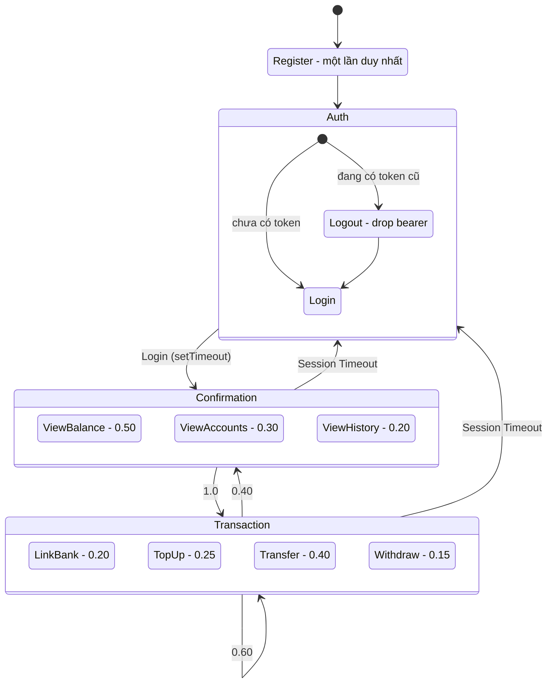

# Kế hoạch kiểm thử hiệu năng: Digital Wallet (SUT)

Phiên bản nháp 2.

## 1. Cấu hình

- Công cụ sinh tải: k6, dùng option/executor native.
- Môi trường: Kaggle CPU (4 core, 32 GB RAM). App, MySQL và k6 chạy chung một máy.
- **1 VU = 1 account.** Mỗi account chạy độc lập trên một VU (Virtual User); hai khái niệm được dùng thay thế nhau. Số VU (hay số account chạy đồng thời) là cấu hình của test.
- **Tham số điều khiển là request/giây (RPS).** tổng số request mỗi giây. Mỗi account tự tính khoảng cách giữa hai request liên tiếp từ `RPS` mục tiêu và số account đang chạy: `gap ≈ accounts / RPS`. Phân phối gap cụ thể (cố định / đều / exponential) do mã nguồn quyết định; đề xuất exponential (Poisson) để mô phỏng thời điểm đến ngẫu nhiên.
- Mỗi session là một bước đi ngẫu nhiên trên máy trạng thái (MDP đơn giản hóa), chi phối bởi gap ở trên.
- Ba loại test: **Smoke**, **Load**, **Stress**.
- Đo từ hai phía: client (k6) và server (Actuator, OS, MySQL

## 2. Kịch bản người dùng (máy trạng thái ngẫu nhiên)

Một session là **vòng đời của một account** trong bài test: đăng ký **một lần duy nhất** khi vào hệ thống, rồi lặp máy trạng thái dưới đây đến hết bài test. Không có trạng thái idle và không có trạng thái kết thúc; đăng xuất chỉ là bỏ token rồi quay lại đăng nhập.

Máy trạng thái chia thành ba khu vực (Register nằm ngoài ba khu vực này). Mỗi lần vào một khu vực, account thực hiện **một** hành động chọn theo tỉ lệ của khu vực đó, rồi chuyển sang khu vực khác.

Chú giải:

- Mỗi ô nhỏ là **một trạng thái thật**. Ô lớn (Auth, Confirmation, Transaction) chỉ nhóm các trạng thái lại cho dễ nhìn, nên mũi tên đi vào hoặc ra khỏi ô lớn áp dụng cho mọi ô con bên trong.
- Số bên cạnh tên ô con là tỉ lệ chọn hành động đó khi account bước vào khu vực. Điều kiện áp dụng (ví dụ LinkBank chỉ khi còn bank chưa liên kết) nằm ở bảng mục 2.2.

### 2.1. Ánh xạ hành động sang API

| Khu vực     | Hành động | Request                                                                    | Auth   |
| ------------ | ------------ | -------------------------------------------------------------------------- | ------ |
| (ngoài)     | Register     | `POST /api/v1/auth/register`                                             | Không |
| Auth         | Login        | `POST /api/v1/auth/login`                                                | Không |
| Auth         | Logout       | Bỏ token ở client, không gửi request (spec không có endpoint logout) |        |
| Confirmation | ViewBalance  | `GET /api/v1/wallets/me`                                                 | Có    |
| Confirmation | ViewAccounts | `GET /api/v1/linked-banks`                                               | Có    |
| Confirmation | ViewHistory  | `GET /api/v1/transactions`                                               | Có    |
| Transaction  | LinkBank     | `POST /api/v1/linked-banks`                                              | Có    |
| Transaction  | TopUp        | `POST /api/v1/transactions/topup`                                        | Có    |
| Transaction  | Transfer     | `POST /api/v1/transactions/transfer`                                     | Có    |
| Transaction  | Withdraw     | `POST /api/v1/transactions/withdraw`                                     | Có    |

Ghi chú: `ViewHistory` không phân trang, trả toàn bộ lịch sử nên phản hồi to dần theo thời gian. Có thể bỏ nếu không cần.

### 2.2. Tỉ lệ hành động và chuyển khu vực

**Hành động trong từng khu vực**

| Khu vực     | Hành động    | Tỉ lệ | Điều kiện                                |
| ------------ | --------------- | ------- | ------------------------------------------- |
| Auth         | Logout / Login | 1.0     | Luôn luôn                                 |
| Confirmation | ViewBalance     | 0.50    |                                             |
| Confirmation | ViewAccounts    | 0.30    |                                             |
| Confirmation | ViewHistory     | 0.20    |                                             |
| Transaction  | LinkBank        | 0.20    | Chỉ khi account còn bank chưa liên kết |
| Transaction  | TopUp           | 0.25    | Chỉ khi đã liên kết ít nhất 1 bank   |
| Transaction  | Transfer        | 0.40    |                                             |
| Transaction  | Withdraw        | 0.15    | Chỉ khi đã liên kết ít nhất 1 bank   |

Khi một hành động không đủ điều kiện, tỉ lệ của các hành động còn lại được chia lại cho tổng bằng 1.

## 3. Ghi chú cho kịch bản

- **Dữ liệu account.**
  - Mỗi account có sẵn K tài khoản ngân hàng có thể liên kết (K ngẫu nhiên từ 5 đến 10, không trùng nhau toàn bài test) và liên kết dần theo thứ tự.
  - Account mới chưa có bank nào thì hai hành động giao dịch đầu tiên bắt buộc là LinkBank rồi TopUp.
  - Việc LinkBank được thực hiện dần dần tới khi account sử dụng hết K tài khoản liên kết. Mỗi lần thực hiện liên kết, xác suất thực hiện LinkBank giảm dần đều, chuyển tỉ lệ đó sang cho Transfer.
  - Username và email chứa mã của lần chạy để không trùng sau khi reset DB.
- **Thiếu tiền.**
  - Client giữ `knownBalance` (cập nhật sau giao dịch thành công, đồng bộ lại ở ViewBalance).
  - Số tiền hợp lệ không vượt `knownBalance`.
  - Với xác suất 0.10 mỗi lần Transfer/Withdraw, client cố ý gửi số tiền vượt số dư (và tự động vượt nếu `knownBalance` nhỏ hơn mức tối thiểu). Sau một giao dịch thiếu tiền, hành động kế tiếp tại khu vực Transaction, dù có đi qua Confirmation trước đó hay không, **bắt buộc là TopUp** vào chính account đó.

* **Request rate.** Mỗi account chờ trung bình `accounts / RPS` giây giữa hai request liên tiếp; mã nguồn lấy giá trị này từ phân phối exponential (Poisson). Trong stress test, `targetRps` tăng theo stage; gap của mỗi account được tính lại theo `accounts_stage / RPS_stage`.
* **Dấu hiệu quá tải của k6.** `dropped_iterations` khác 0 hoặc `maxVUs` chạm trần (k6-client đạt ngưỡng). Khi này bộ test không còn phù hợp với SUT.

- **Token Timeout.** Mỗi lần đăng nhập, T lấy từ phân phối chuẩn quanh giá trị trung bình μ (cấu hình), giới hạn trong khoảng ±30% của μ. T hết hạn thì account bỏ token (Logout), quay về Auth, đăng nhập lại rồi vào Confirmation. JWT thật có hạn 24 giờ nên timeout hoàn toàn do client mô phỏng.
- **Think time.** Khoảng chờ giữa hai hành động liên tiếp của một account, cấu hình theo từng loại test.
- **Ví nhận của Transfer.** Các account chạy song song không biết số ví của nhau, nên `setup()` tạo sẵn một nhóm ví nhận (số lượng cấu hình theo từng loại test) và Transfer chọn ngẫu nhiên một ví trong nhóm. Đánh đổi: giao dịch tập trung vào ít ví hơn thực tế, có thể gây tranh chấp khóa.
- **Open model.** Arrival-rate điều khiển tốc độ account được kích hoạt. Mỗi session chạy đến thời điểm kết thúc bài test (mốc do `setup()` ghi), nên mỗi account chiếm một VU suốt thời gian đó và `maxVUs` phải lớn hơn số account tối đa.

* **Phân loại kết quả.** Lỗi thiếu tiền có chủ đích là kết quả kỳ vọng (client tự đánh dấu expected = `400` khi gửi amount vượt `knownBalance`). Mọi 5xx, timeout hoặc mã không khớp expected đều là failure; `Rate('unexpected_failure')` được phát cho từng request để phục vụ threshold và visualize.
* **Đối soát số dư tại client.** Sau mỗi `ViewBalance` (200), client so `knownBalance` với `data.balance` trong response. Khớp ⇒ cập nhật `knownBalance` và tiếp tục. Lệch ⇒ ghi một dòng `invariant_violation` vào nhật ký monitor (có `account`, `username`, `wallet_id`, `client`, `server`), đánh dấu account là dead, VU thay bằng account mới và tiếp tục.  CSV `invariant_violation` là nguồn dữ liệu cho bước dump DB (chỉ dump những người dùng bị violation).

## 4. Các loại kiểm thử và thứ tự thực hiện

**Thứ tự thực hiện và ngân sách thời gian.**

- Chạy lần lượt: Postman Collection (xác nhận hành vi API và mã lỗi) → Smoke → Load → Stress. Chỉ chuyển bước khi bước trước ổn.
- Trước mỗi bài test: reset DB và khởi động lại app để các lần chạy so sánh được với nhau.
- Thời lượng k6 theo kế hoạch: Smoke 3 phút, Load 32 phút, Stress 30 phút, tổng khoảng 65 phút, chưa kể thời gian cài đặt, khởi động và phân tích. Ở chế độ commit của Kaggle, tiến trình nền chết khi cell cuối kết thúc, nên cell cuối phải chờ k6 chạy xong.

### 4.1. Smoke Test

**Mô tả.** Chạy với số account rất nhỏ, đủ lâu để mọi trạng thái và mọi chuyển khu vực đều xảy ra ít nhất một lần.

**Mục tiêu.**

- Mọi hành động trong mục 2.1 trả phản hồi đúng cấu trúc và đúng mã.
- Các cơ chế của kịch bản hoạt động: liên kết dần K bank, TopUp bắt buộc sau lỗi thiếu tiền, timeout rồi đăng nhập lại.
- Script k6, `setup()` và phần đối soát số dư chạy đúng trước khi dùng tải lớn.

**Thông số.**

| Mục             | Giá trị                                                       |
| ---------------- | --------------------------------------------------------------- |
| Số account      | 5 (cố định), kích hoạt trong 10 giây                      |
| RPS mục tiêu   | 5 (gap trung bình ~1 giây/account)                            |
| Ví nhận        | 10                                                              |
| Thời lượng    | 3 phút (bao gồm 10 giây activation)                          |
| Timeout token μ | 20 giây (±30%), đủ ngắn để đăng nhập lại nhiều lần |

**Tiêu chí đạt.** Mọi `check` đúng; không có 5xx; `unexpected_failure` = 0; mọi hành động ở mục 2.1 xuất hiện ít nhất một lần, kể cả TopUp bắt buộc và đăng nhập lại sau timeout; ít nhất một probe cho mỗi mã 401 / 400 / 404; không có `invariant_violation`.

### 4.2. Load Test

**Mô tả.** Số account cố định, tải ổn định theo cấu hình đặt trước, dùng để đo hành vi cơ sở của hệ thống.

**Mục tiêu.**

- Ghi nhận đường chuẩn: latency (p50, p95, p99), throughput thực, tỉ lệ lỗi, CPU/RAM/GC/connection pool ở một mức tải cố định.
- Có số liệu để so sánh với Stress và với các lần chạy sau khi tối ưu.

**Thông số.**

| Mục                 | Giá trị                                          |
| -------------------- | -------------------------------------------------- |
| Số account          | 200 (cố định), kích hoạt đều trong 2 phút  |
| RPS mục tiêu       | 100 (gap trung bình ~2 giây/account)             |
| Ví nhận            | 50                                                 |
| Thời gian giữ tải | 30 phút sau khi kích hoạt xong (tổng 32 phút) |
| Timeout token μ     | 5 phút (±30%)                                    |

**Kết quả ghi nhận.** Không có ngưỡng đạt/không đạt về hiệu năng. Đối soát số dư phải khớp (Không có `invariant_violation`).

### 4.3. Stress Test

**Mô tả.** Số account tăng dần theo từng bậc cho đến khi hệ thống suy giảm hoặc hỏng. Account đã kích hoạt tiếp tục chạy đến hết bài test, nên tải chỉ tăng chứ không giảm.

**Mục tiêu.**

- Xác định điểm gãy: bậc đầu tiên mà lỗi bất ngờ xuất hiện liên tục hoặc latency tăng vọt so với bậc trước.
- Xác định nút thắt (CPU, đặc biệt BCrypt ở Register/Login, connection pool Hikari, thread của Tomcat, khóa MySQL hoặc GC) và kiểu hỏng (suy giảm dần hay đổ vỡ đột ngột).
- Kiểm tra tính đúng đắn của số dư sau khi chịu quá tải.

**Thông số.**

| Mục             | Giá trị                                                                                   |
| ---------------- | ------------------------------------------------------------------------------------------- |
| Số account      | Tăng thêm 200 account mỗi bậc, 10 bậc, tối đa 2.000 account                          |
| RPS mục tiêu   | Tăng thêm 100 RPS mỗi bậc, từ 100 đến 1.000 RPS                                      |
| Mỗi bậc        | Kích hoạt 200 account trong 60 giây, giữ thêm 120 giây (3 phút/bậc, tổng 30 phút) |
| Ví nhận        | 100                                                                                         |
| Timeout token μ | 5 phút (±30%), giống Load để so sánh                                                  |

**Điều kiện dừng.** Chạy hết 10 bậc, hoặc dừng sớm khi hệ thống sụp (app hoặc MySQL chết, hoặc `unexpected_failure` ở mức rất cao kéo dài vài phút; ngưỡng cụ thể là cấu hình).

**Sau khi dừng tải.** Chạy lại Smoke để kiểm tra hệ thống còn phục vụ đúng, rồi đối soát số dư. Cách này thay cho bước hạ tải để quan sát phục hồi, vì account không tự thoát khỏi hệ thống.

## 5. Một số lưu ý khác:

1. **Giới hạn liên kết ngân hàng.** Mỗi ví không bị giới hạn số tài khoản bank liên kết, và phải tự thêm tài khoản liên kết. Hành động top-up sẽ chuyển tiền từ tài khoản liên kết tới số dư chung của ví (mặc định luôn thành công).
2. **Rate limiting hoặc khóa tài khoản.** Không có.
3. **Các giá trị tự gán** (xác suất ở mục 2.2, μ, think time, số account mỗi bậc) có thể thay thế (configuration của test).
