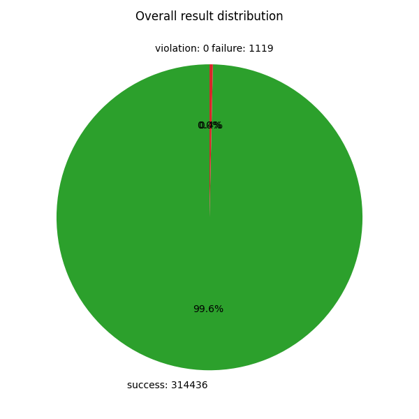
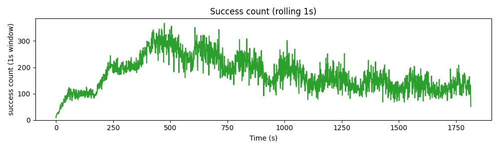
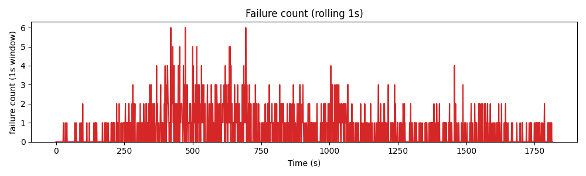
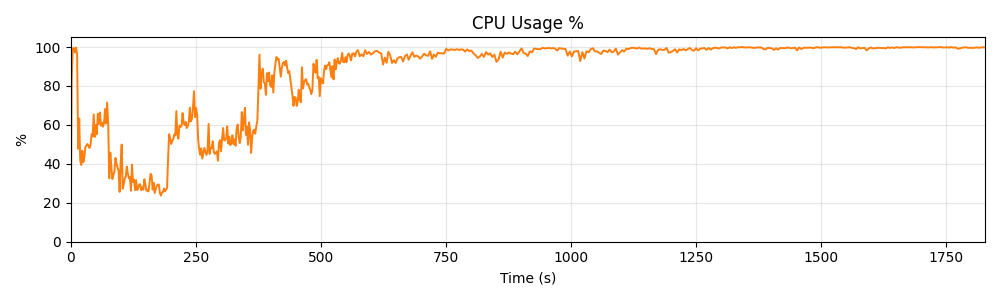
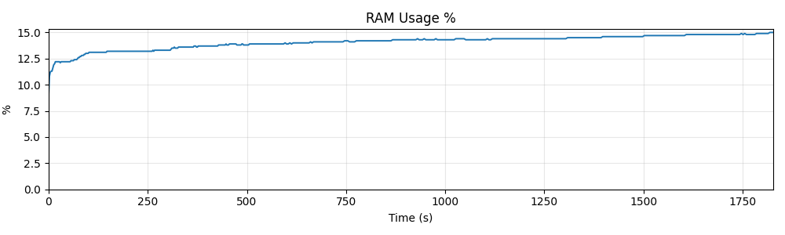
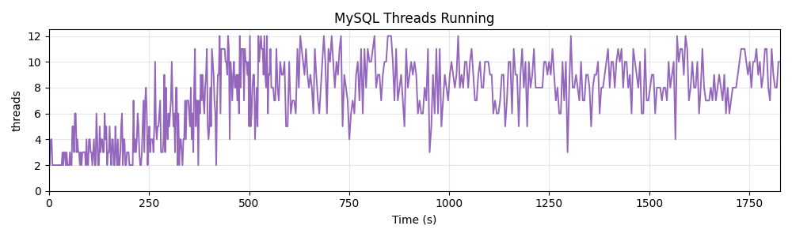

# Báo cáo Quy trình và Kết quả Kiểm thử Hiệu năng (Stress Test) - Digital Wallet

## 1. Tổng quan Mô hình và Quy trình Thực hiện

### 1.1. Mô hình kiểm thử

Hệ thống được kiểm thử hiệu năng bằng công cụ **k6**, sử dụng mô hình tải mở (Open Model), trong đó **1 VU (Virtual User) mô phỏng tương ứng 1 account**. Mỗi account sẽ chạy độc lập và thực hiện vòng đời của mình thông qua một máy trạng thái (State Machine) luôn chuyển giữa các trạng thái:

* **Register (Đăng ký):** Chỉ thực hiện một lần duy nhất khi account bắt đầu vào hệ thống.
* **Auth:** Đăng nhập/Đăng xuất. Thời gian sống của token (timeout) được mô phỏng theo phân phối chuẩn (μ ± 30%).
* **Confirmation:** Thực hiện các thao tác xem (ViewBalance, ViewAccounts, ViewHistory).
* **Transaction:** Thực hiện các giao dịch (LinkBank, TopUp, Transfer, Withdraw).

Các request được sinh ra liên tục với khoảng thời gian (gap) tuân theo phân phối exponential (Poisson) nhằm thỏa mãn tham số `RPS` (Requests Per Second) mục tiêu/được config từ trước. Bên cạnh đó, hệ thống cũng mô phỏng các kịch bản lỗi (thiếu tiền, phải TopUp bắt buộc), và duy trì `knownBalance` ở phía client để đối soát.

### 1.2. Quy trình thực hiện

Quy trình kiểm thử được thực hiện tuần tự nhằm đảm bảo tính ổn định trước khi nâng cao tải:

1. **Chạy Postman Collection:** Xác nhận hành vi API và mã lỗi cơ bản.
2. **Smoke Test (3 phút):** Chạy với 5 account để đảm bảo mọi trạng thái, cơ chế (liên kết ngân hàng, timeout, đối soát) hoạt động đúng.
3. **Load Test (32 phút):** 200 account, RPS mục tiêu 100. Dùng để đo đường chuẩn (baseline) về latency, throughput, tài nguyên.
4. **Stress Test (30 phút):** Tăng tải theo từng bậc (10 bậc, mỗi bậc thêm 200 account và 100 RPS) cho đến khi hệ thống suy giảm hoặc sụp đổ.

*(Trước mỗi bài test, DB được reset và app được khởi động lại để đảm bảo tính nhất quán).*

### 1.3. Phân loại kết quả Request

Trong suốt quá trình test, các request được phân loại nghiêm ngặt như sau:

* **Success:** Request trả về HTTP status đúng với mong muốn theo tài liệu [API-docs](../swaggerAPI/api-docs.json). Ví dụ: `200 OK`, `201 Created`, hoặc `400 Bad Request` đối với các trường hợp cố ý gửi sai (thiếu tiền).
* **Failure:** Các request trả về mã 5xx, timeout, hoặc mã HTTP không khớp với kỳ vọng.
* **Violation:** Cờ đánh dấu các trường hợp sai lệch số dư. Xảy ra khi giao dịch báo thành công tới client nhưng việc chuyển khoản không được ghi nhận, hoặc bị ghi nhận 2 lần (sai lệch giữa `knownBalance` của client và `data.balance` từ server). Đây là các trường hợp nghiêm trọng nhất, các account gặp violation sẽ được bỏ qua bởi môi trường test và tách ra report riêng.

---

## 2. Hướng dẫn Cài đặt và Chạy chương trình

> 💡 **Lưu ý:** Để xem chi tiết cách cài đặt môi trường, cấu trúc thư mục, cách chạy test local hoặc trên Kaggle, vui lòng tham khảo tài liệu tại [`README.md`](../../digitalwallet-stress-test/README.md).

---

## 3. Kết quả Stress Test & Phân tích

Dưới đây là kết quả ghi nhận từ bài Stress Test (tăng tải dần đều qua các bậc).

### 3.1. Nhận xét chung

* **Về thông số hiệu năng:** Hệ thống có dấu hiệu quá tải rõ rệt. Success count (số lượng request thành công) đạt đỉnh khoảng **~300 req/s** ở giai đoạn giữa bài test. Tuy nhiên, sau đó throughput sụt giảm nghiêm trọng và dao động chỉ còn khoảng **100 - 200 req/s** dù RPS của phiên test vẫn tiếp tục được tăng.
-> Nguyên nhân: Do mức sử dụng CPU đã đạt đỉnh ở giữa phiên, phần mềm test (k6) chiếm dụng CPU để tăng RPS, khiến cho SUT bị mất tài nguyên xử lý.
* **Về tài nguyên:** Tương ứng với giai đoạn đỉnh điểm của Success count, CPU Usage tăng vọt và chạm ngưỡng tối đa **100%** từ giữa bài test. Đây là dấu hiệu rõ ràng của việc CPU trở thành nút thắt cổ chai (bottleneck) chính, trong khi vẫn còn thừa RAM chưa được tận dụng.
* **Về Failure:** Số lượng failure tăng cao và xuất hiện liên tục, đặc biệt nổi bật ở giai đoạn từ giây thứ 400 trở đi (trùng với thời điểm CPU đạt 100%).
* **Về Violation:** Không xảy ra bất kỳ `invariant_violation` nào. Điều này chứng tỏ tính toàn vẹn dữ liệu (số dư) vẫn được đảm bảo ở tầng logic nghiệp vụ, dù hệ thống đang bị nghẽn ở tầng hạ tầng.

### 3.2. Insight về Failure

Mặc dù không có violation về số dư, nhưng failure lại xuất hiện liên tục. Phân tích log chỉ ra rằng, toàn bộ các failure là lỗi **409 Conflict**.

* **Nguyên nhân:** Lỗi này xảy ra chủ yếu ở các hành động `Withdraw` (Rút tiền) và `Transfer` (Chuyển khoản). Khi concurrency (số lượng tác vụ đồng thời) tăng cao, các giao dịch này cố gắng cập nhật cùng một bản ghi số dư (hoặc cùng một nhóm ví nhận) tại cùng một thời điểm.
* **Cơ chế khóa (DB Lock):** MySQL đã áp dụng cơ chế khóa (Lock) để bảo vệ dữ liệu. Những request đến sau khi bản ghi đang bị lock bởi một transaction khác đã bị từ chối và trả về mã 409. Điều này cho thấy hệ thống đang bảo vệ dữ liệu đúng (không cho ghi đè hỏng số dư), nhưng chưa có cơ chế xử lý khi tải cao.

---

### 3.3. Hình ảnh minh họa

*(Các biểu đồ được lưu trữ trong thư mục [figures](./figures/results))*

## 4. Định hướng phát triển

* **Sửa cơ chế stress test:** Do việc k6 đang chiếm dụng CPU của SUT, việc tách 2 chương trình sang 2 instance là cần thiết. Nhưng có thể gây thêm nghẽn từ đường truyền khi làm việc trên môi trường Kaggle.
* **Sửa cơ chế lock:** Ta có thể đơn giản retry các giao dịch thêm một vài lần sẽ giảm mạnh tỉ lệ lỗi. Hoặc bổ sung cache hoặc các cơ chế ghi hàng loạt, shard để giảm tài nguyên dành cho DB MySQL. Hoặc nếu cần thiết, chấp nhận violation trong khoảng thời gian ngắn sau mỗi giao dịch.

### Note công việc cho test version 2

* Tách 2 notebook và stress test qua trung gian Ngrok Tunnel.
* Bổ sung kịch bản để chấp nhận violation trong thời gian ngắn.
